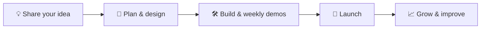

<!-- ───────────────────────── HERO ───────────────────────── -->

  

  

  
  
  

---

## ✨ Ideas, built and launched

**NinjaNext Technologies** turns ideas into polished apps and AI-powered products, and takes them all the way to launch.

Whether you are a startup with a new idea or a business that wants to work smarter, NinjaNext handles everything: product design, mobile and web apps, AI features, store launch and growth.

> 🚀 **One partner, from idea to launch.** You get a clear plan, steady progress you can see, and a product that's ready for real customers.

---

## 💼 What NinjaNext does for you

<table>
<tr>
<td width="50%" valign="top">

### 🤖 AI for your business
Put AI to work in your business: assistants that answer customers 24/7, smart search across your documents, and automation that removes repetitive work so your people can focus on what matters.

</td>
<td width="50%" valign="top">

### 📱 Mobile apps
Beautiful, fast apps for Android and iPhone that customers enjoy using, built to launch on Google Play and the App Store.

</td>
</tr>
<tr>
<td width="50%" valign="top">

### 🌐 Websites & platforms
Websites, booking systems, customer portals and admin dashboards that grow with your business.

</td>
<td width="50%" valign="top">

### 📈 Smart insights
Dashboards and AI-driven insights that turn your data into clear decisions.

</td>
</tr>
<tr>
<td width="50%" valign="top">

### 🎮 Games & consumer apps
Engaging games and lifestyle apps with great design, smooth play and loyal users.

</td>
<td width="50%" valign="top">

### 🚀 Launch & growth
Store listings, screenshots, privacy policies and social media launch kits, so your product launches looking its best.

</td>
</tr>
</table>

---

## 🌟 NinjaNext products

<table>
<tr>
<td width="50%" valign="top">

### 🧩 One Room Left: Mystery Escape
*One room. One lost hour. Many secrets.*

A story-driven escape-room mystery. You wake in a locked study, the clock stopped at 11:47, holding a note in your own handwriting. Solve puzzles, uncover secrets and choose how the story ends.

🟣 **Coming soon to Google Play**

</td>
<td width="50%" valign="top">

### 🕌 MuslimApp
*Your daily companion for prayer and remembrance.*

Accurate prayer times and reminders, Qibla compass, Tasbeeh counter, Zakat calculator and Hijri date. In English, Urdu and Arabic, and it works fully offline.

🟢 **Android**

</td>
</tr>
<tr>
<td width="50%" valign="top">

### 🎨 MoodCanvas
*Your life, one shade at a time.*

A private mood journal where each day becomes a colour, and over time your days paint a beautiful mosaic of your life.

🟢 **Android**

</td>
<td width="50%" valign="top">

### 📊 Cognix
*Smarter market decisions.*

AI-assisted trading insights for crypto, forex and binary markets, with clear buy and sell signals, confidence scores and risk insights.

🔵 **Coming soon**

</td>
</tr>
<tr>
<td width="50%" valign="top">

### 🧭 Qibla Compass
*Find the Qibla anywhere.*

A simple, accurate Qibla finder that's ready the moment you open it.

🟢 **Android**

</td>
<td width="50%" valign="top">

### 🃏 MemoryMaster
*Train your memory. Have fun doing it.*

A colourful card-matching game with animals, fruits and numbers, for kids and adults.

🟢 **Mobile**

</td>
</tr>
</table>

> 🔒 **Privacy first.** NinjaNext's own apps need no account and show no ads, and your personal data stays on your phone.

---

## 🤝 Trusted by businesses in

| | Industry | Built for clients |
|:-:|---|---|
| 🩺 | **Healthcare** | **HSA Second Opinion** connects patients with specialist doctors for expert medical second opinions, with apps for patients and doctors. |
| 🚗 | **Mobility** | A complete **ride-hailing** service with rider and driver apps and a live operations dashboard. |
| ✈️ | **Travel** | **FreeToGo** is a travel platform with a website and mobile apps for planning and booking trips. |
| 🔧 | **Automotive** | **SwiftFix Auto** (UK) has a modern website and booking system for an MOT and car repair garage. |
| 🍽️ | **Hospitality** | **Jazzkeller** offers online ordering for guests, with a management app for staff. |
| ⚡ | **Brands** | **KiFlash** has a business website built to convert visitors. |

---

## 🧭 How we work together

1. **Share your idea.** A free call to understand your goals and your customers.
2. **Plan & design.** A clear scope, timeline and screen designs before any build starts.
3. **Build with weekly demos.** You see real progress every week and give feedback as it happens.
4. **Launch.** Store listing, privacy policy and launch materials are all handled.
5. **Grow.** Updates, new features and AI upgrades as your business grows.

---

## 💡 Why NinjaNext

<table>
<tr>
<td align="center" width="25%">⚡ <b>Fast delivery</b> AI-assisted building gets you to launch sooner</td>
<td align="center" width="25%">🎯 <b>One point of contact</b> You talk directly to the person building your product</td>
<td align="center" width="25%">🔒 <b>Privacy first</b> Your data and your customers' data are respected</td>
<td align="center" width="25%">🌍 <b>Worldwide</b> Clients in Pakistan, the UK and beyond</td>
</tr>
</table>

---

## 📬 Let's build something great

Have an idea for an app, want AI working in your business, or need a product launched the right way?

  
  

Founded and led by <b>Muhammad Saqib Javed</b> · Lahore, Pakistan

  

