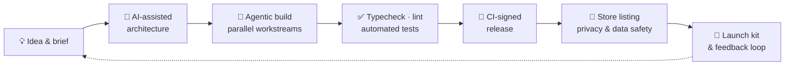

<!-- ───────────────────────── HERO ───────────────────────── -->
<p align="center">
  
</p>

<p align="center">
  <a href="https://readme-typing-svg.demolab.com"></a>
</p>

<p align="center">
  <a href="https://ninjanexttech.com"></a>
  <a href="mailto:ask@ninjanexttech.com"></a>
  
</p>

<p align="center">
  
  
  
  
  
</p>

---

## ⚡ What NinjaNext is

**NinjaNext Technologies** is an AI-native product and engineering studio. It designs, builds and ships software end to end: from the first prompt and architecture sketch to a signed release on the store.

AI is part of how every product is *built* (agentic coding, automated review, generated test suites and release pipelines) and, where it earns its place, part of what the product *does*: assistants, agents, smart search, signal engines and on-device intelligence.

> **Small studio, full stack, fast loops.** One accountable owner per product, AI agents doing the heavy lifting, and humans making the calls that matter.

---

## 🧠 AI capabilities

<table>
<tr>
<td width="50%" valign="top">

### 🤖 Agents & automation
- Tool-using **AI agents** wired into real APIs, databases and workflows
- **Model Context Protocol (MCP)** servers that connect assistants to business data
- Multi-step orchestration with guardrails, approvals and audit logs
- Back-office automation: documents, reports, triage, data entry

</td>
<td width="50%" valign="top">

### 💬 LLM product features
- Chat assistants and copilots inside web and mobile apps
- **RAG** over company knowledge: retrieval, citations, freshness
- Structured extraction, classification and summarisation pipelines
- Evals, prompt versioning and cost / latency tuning

</td>
</tr>
<tr>
<td width="50%" valign="top">

### 📈 Intelligence & analytics
- Real-time signal engines with confidence scoring
- Backtesting, risk analysis and decision dashboards
- Forecasting and anomaly detection on operational data

</td>
<td width="50%" valign="top">

### 📱 On-device & private AI
- Offline-first apps where data never leaves the phone
- On-device inference where it fits; cloud only when it is needed
- Privacy reviews, data-safety declarations and clear policies

</td>
</tr>
</table>

---

## 🚀 Products

| | Product | What it is | Status |
|:-:|---|---|---|
| 🧩 | **One Room Left: Mystery Escape** | A story-driven offline escape-room game. The clock stopped at 11:47, the door is locked, and the note on the desk is in your own handwriting. Multiple endings, three-level hints, a daily mystery. | 🟣 Launching on Google Play · [Privacy](https://ninjanext.github.io/oneroomleft-privacy/) |
| 🕌 | **MuslimApp** | A calm daily companion for prayer and remembrance: on-device prayer times (10 calculation methods, Hanafi/Standard Asr), exact prayer reminders, Qibla compass, Tasbeeh, Zakat calculator and Hijri date. English, Urdu and Arabic (RTL), light and dark, phone and tablet. No accounts, ads, analytics or internet permission. | 🟢 Android |
| 🧭 | **Qibla Compass** | A focused, lightweight Qibla finder corrected to true north, with calibration help. | 🟢 Android |
| 🎨 | **MoodCanvas** | A private visual mood journal. Pick a colour each day and watch your entries paint a *Living Mood Mosaic*. No account, no ads, no tracking. | 🟢 Android · [Privacy](https://ninjanext.github.io/moodcanvas-privacy/) |
| 🃏 | **MemoryMaster** | A card-matching memory game with animal, fruit and number themes, sound effects and haptics. | 🟡 Mobile game |
| 📊 | **Cognix** | Multi-market trading intelligence for crypto, forex and binary markets. Real-time indicators, long/short signals with confidence scores, backtesting, risk analysis, automated execution and Telegram signal delivery. | 🔵 In development |

---

## 🏗️ Client platforms

NinjaNext builds complete multi-app platforms (customer app, partner app, admin panel, backend):

| Platform | Domain | Delivered |
|---|---|---|
| 🩺 **HSA Second Opinion** | Healthcare | Medical second-opinion platform: patient and doctor apps on Android and iOS, admin web, Node.js/MongoDB and Kotlin backends |
| 🚗 **Ride-Hailing System** | Mobility | Rider and driver apps for Android and iOS, operations dashboard, Java dispatch backend |
| ✈️ **FreeToGo** | Travel | Travel platform: website, Android/iOS and React Native apps, admin panel, Kotlin backend |
| 🔧 **SwiftFix Auto** | Automotive (UK) | Website for a DVSA-approved MOT and repair garage, admin panel and Kotlin backend |
| 🍽️ **Jazzkeller** | Hospitality | Customer web app with a companion admin app |
| ⚡ **KiFlash** | Web | WordPress website |

`Healthcare` · `FinTech` · `Mobility` · `Travel` · `Hospitality` · `Automotive` · `Faith & Lifestyle` · `Gaming`

---

## 🔒 Repository portfolio

Most NinjaNext code lives in **private repositories** (client IP and products before launch). Here is what's inside:

<details>
<summary><b>38 repositories · 3 public · 35 private</b> (click to expand)</summary>

<br/>

| Project | Repositories | Stack |
|---|---|---|
| **One Room Left** | 🔒 `OneRoomLeft` · 🌐 [`oneroomleft-privacy`](https://github.com/NinjaNext/oneroomleft-privacy) | Expo · React Native · TypeScript · SQLite |
| **MoodCanvas** | 🔒 `MoodCanvas` · 🌐 [`moodcanvas-privacy`](https://github.com/NinjaNext/moodcanvas-privacy) | Expo · React Native · TypeScript · SQLite |
| **MuslimApp** | 🔒 `MuslimApp` · 🔒 `MuslimApp-QiblaCompass` | Android · Java |
| **MemoryMaster** | 🔒 `MemoryMaster` | Expo · React Native · TypeScript |
| **Cognix** | 🔒 `Cognix` · 🔒 `CognixAdminPanel` | Kotlin · PostgreSQL · Python · TypeScript |
| **HSA Second Opinion** | 🔒 `HSASecondOpinion-Android` · `-FirebaseAndroid` · `-IOS` · `DoctorApp` · `IOSDoctorApp` · `Admin` · `Admin-WEB` · `BackendGradle` · `HSABackend-Kotlin` · `Details` | Kotlin · Swift · React · Node.js · MongoDB · Firebase |
| **Ride-Hailing** | 🔒 `RIDE-HAILING-Rider-Android` · `-Driver-Android` · `-Rider-IOS` · `-Driver-IOS` · `-FE` · `-BE` | Kotlin · Swift · React · TypeScript · Java |
| **FreeToGo** | 🔒 `FreeToGoWebsite` · `FreeToGoApp` · `FreeToGo-Android-App` · `FreeToGo-IOS-App` · `FreeToGo-Admin-Panel` · `FreeToGo-Backend` | TypeScript · React Native · Kotlin |
| **SwiftFix Auto** | 🔒 `SwiftFix-Website` · `SwiftFix_Admin` · `SwiftFixAuto_Backend` | Next.js · Tailwind · TypeScript · Kotlin |
| **Jazzkeller** | 🔒 `JazzkellerWebCustomerApp` · `JazzkellerWebAdminApp` | React · JavaScript |
| **KiFlash** | 🔒 `KiFlash-Wordpresss` | WordPress |
| **Org** | 🌐 [`.github`](https://github.com/NinjaNext/.github) | Profile & templates |

</details>

---

## 🔁 How products get built



- **Spec first.** A short architecture contract that every workstream builds on.
- **Agents in parallel.** Independent modules are built side by side and merged behind tests.
- **Quality gates.** Strict TypeScript, linting and hundreds of automated tests before anything ships.
- **Releases are automated.** Push to `production` and CI produces a signed build. No laptop builds, no manual signing.
- **Launch-ready.** Store copy, screenshots, privacy policy and social assets come with the product.

---

## 🛠️ Tech stack

<p align="center"><b>AI & data</b><br/>
  
  
  
  
  
  
</p>

<p align="center"><b>Mobile</b><br/>
  
</p>

<p align="center"><b>Web & backend</b><br/>
  
</p>

<p align="center"><b>Cloud & delivery</b><br/>
  
</p>

---

## 🧭 Principles

```text
→ AI where it adds value, never as decoration
→ Private by default: collect nothing you don't need
→ Offline-first when the product allows it
→ Tests and CI before features
→ Every release is reproducible and signed
→ Ship small, ship often, listen to users
```

---

## 🤝 Work with NinjaNext

Need an AI feature in an existing product, an agent that automates a workflow, or a new app built and launched end to end?

<p align="center">
  <a href="mailto:ask@ninjanexttech.com?subject=Project%20enquiry"></a>
  <a href="https://ninjanexttech.com"></a>
</p>

<p align="center"><sub>Founded and led by <b>Muhammad Saqib Javed</b> · Lahore, Pakistan</sub></p>

<p align="center">
  
</p>
